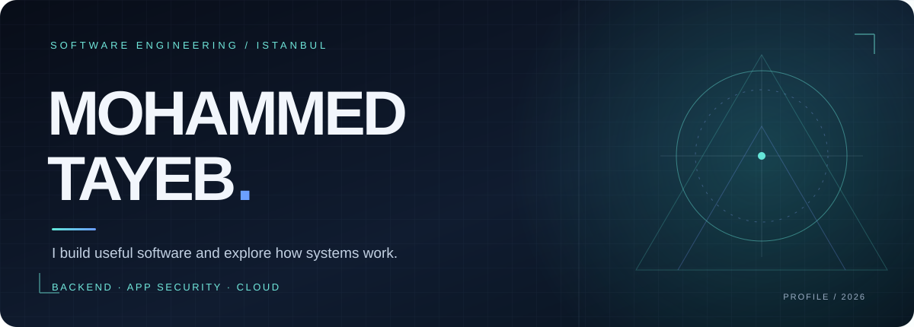

  

  <a href="https://github.com/tayeb123tta">GitHub Profile</a>
  &nbsp;&nbsp;·&nbsp;&nbsp;
  Istanbul Nişantaşı University
  &nbsp;&nbsp;·&nbsp;&nbsp;
  Software Engineering

 

## Hello, I'm Mohammed.

I'm a Software Engineering student interested in the craft of building useful, dependable software. I enjoy working across the stack, with a growing focus on backend systems, application security, and cloud infrastructure.

I learn by making things: shaping an idea, turning it into a working product, and refining the details that make it reliable.

## Areas of focus

**Backend engineering**  
APIs, server-side architecture, authentication, data modelling, and maintainable services.

**Application security**  
Secure-by-design thinking, authorization, validation, and web security fundamentals.

**Cloud & infrastructure**  
Linux, networking, deployment, and the foundations of reliable systems.

## Selected projects

**3llemni**  
A multilingual electronics commerce platform with a configurable storefront and visual administration studio.  
*React · TypeScript · Express · SQLite*

**Commerce OS**  
A desktop point-of-sale and inventory concept designed around real shop workflows and offline-first operation.  
*Tauri · React · SQLite*

**Sahara Gold**  
A multi-tenant restaurant ordering concept with QR menus and store management.  
*React · Supabase*

## Technologies

  

## Learning now

Backend architecture · Application security · Cloud infrastructure

 

  Curiosity, consistency, and the work behind the interface.

