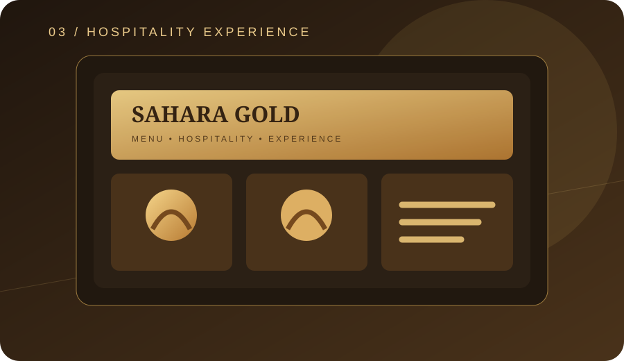

  
   
  

    
    
    
  

---

## 01 / A LITTLE ABOUT ME

I'm **Mohammed Tayeb**, a Software Engineering student at **Istanbul Nişantaşı University**.

I like understanding how things work beneath the interface — from backend logic and data flow to the security and infrastructure behind a reliable product.

Currently focused on:
- ⚙️ **Backend engineering** — APIs, application structure, databases
- 🛡️ **Application security** — secure development and practical web security
- ☁️ **Cloud & infrastructure** — Linux, networking, deployment fundamentals

I learn by building, testing, breaking things, and improving them.

## 02 / SELECTED WORK

01 — COMMERCE PLATFORM

### 3llemni
A multilingual electronics commerce platform with a customer storefront and a configurable visual administration studio.

**React** · **TypeScript** · **Express** · **SQLite**

02 — DESKTOP / RETAIL OPERATIONS

### Commerce OS
A point-of-sale and inventory desktop concept focused on practical retail workflows, responsive performance, and offline-first operation.

**Tauri** · **React** · **SQLite**

03 — HOSPITALITY / SAAS

### Sahara Gold
A multi-tenant restaurant platform exploring QR menus, digital ordering, and business management.

**React** · **Supabase**

## 03 / CURRENT TOOLKIT

  

## 04 / WHAT I'M WORKING TOWARDS

<table>
  <tr>
    <td width="33%" valign="top">
      <h3>⚙ Backend</h3>
      DESIGN · BUILD · MAINTAIN
      
Well-structured APIs, authentication, database design, and dependable server-side systems.

    </td>
    <td width="33%" valign="top">
      <h3>🛡 Security</h3>
      UNDERSTAND · TEST · IMPROVE
      
Secure coding, access control, validation, and application security fundamentals.

    </td>
    <td width="33%" valign="top">
      <h3>☁ Infrastructure</h3>
      CONNECT · DEPLOY · SCALE
      
Linux, networking, deployment workflows, and cloud infrastructure foundations.

    </td>
  </tr>
</table>

## 05 / GITHUB IN NUMBERS

  
  &nbsp;
  

   
  STUDENT BY TITLE. BUILDER BY HABIT.
    
  <a href="https://github.com/tayeb123tta?tab=repositories">EXPLORE REPOSITORIES ↗</a>

