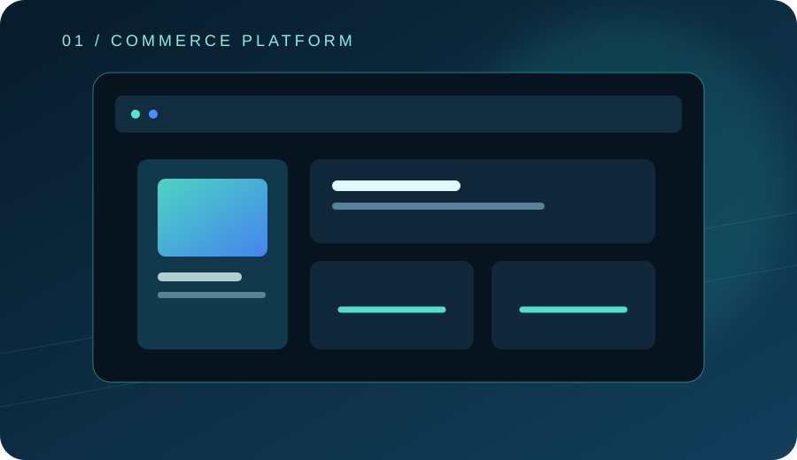
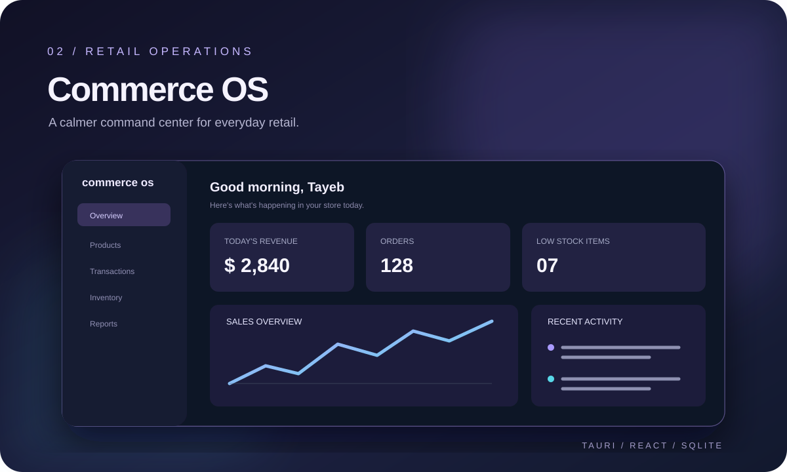

  

  
  
  

 

<h2 align="center">A little about me</h2>

  I'm Mohammed Tayeb, a Software Engineering student at Istanbul Nişantaşı University. 
  I enjoy building practical digital products and understanding the engineering behind them. 
  My current focus is backend development, application security, and cloud infrastructure.

 

<h2 align="center">Selected work</h2>

A few products and ideas I'm actively developing.

<table>
<tr>
<td width="50%" valign="top">
  
  <h3>01. 3llemni</h3>
  
A multilingual electronics commerce platform with a configurable storefront and a visual administration studio.

  
<strong>React · TypeScript · Express · SQLite</strong>

</td>
<td width="50%" valign="top">
  
  <h3>02. Commerce OS</h3>
  
A desktop point-of-sale and inventory concept focused on fast workflows and offline-first operation.

  
<strong>Tauri · React · SQLite</strong>

</td>
</tr>
<tr>
<td width="50%" valign="top">
  
  <h3>03. Sahara Gold</h3>
  
A multi-tenant restaurant platform exploring QR menus, online ordering, and business management.

  
<strong>React · Supabase</strong>

</td>
<td width="50%" valign="top">
  <h3>04. What I'm learning</h3>
  
Going deeper into the foundations that make software robust, secure, and ready to scale.

  <ul>
    <li>Backend architecture and API design</li>
    <li>Application security and secure coding</li>
    <li>Linux, networking, and cloud fundamentals</li>
  </ul>
</td>
</tr>
</table>

 

<h2 align="center">Tech stack</h2>

  

<h2 align="center">GitHub overview</h2>

  
  

 

  Thanks for visiting — always building, learning, and improving.

